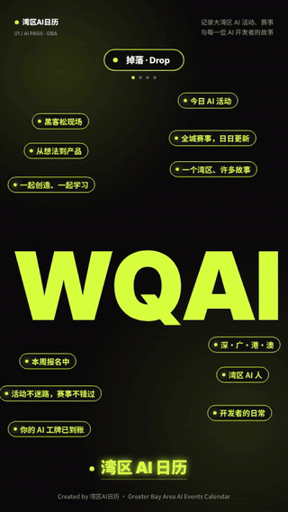
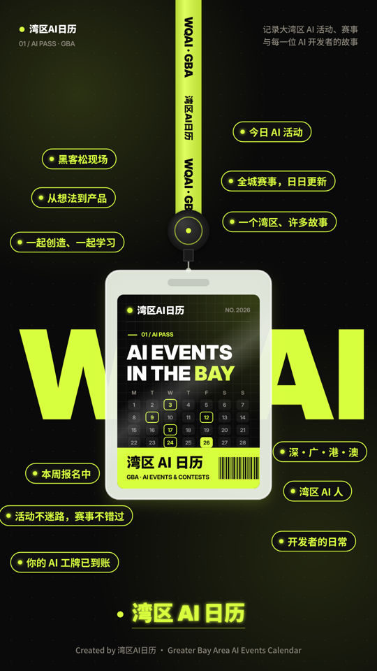
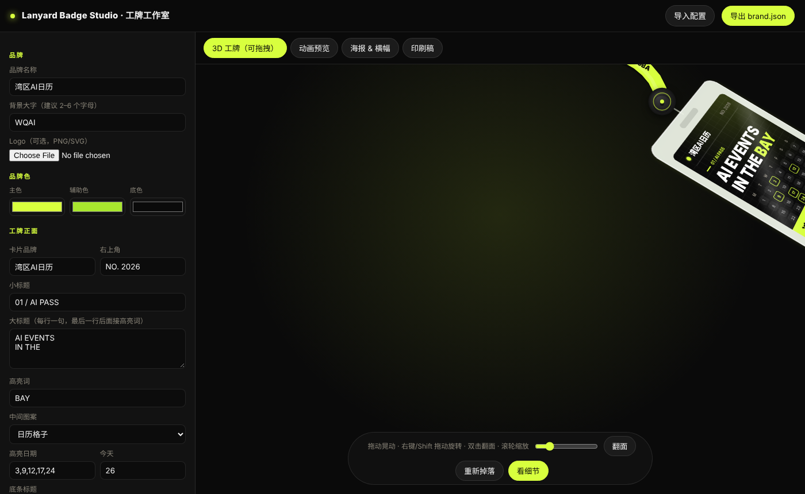
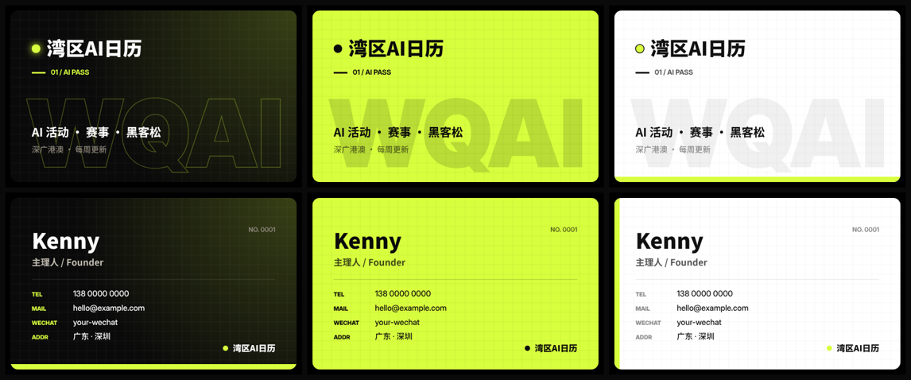
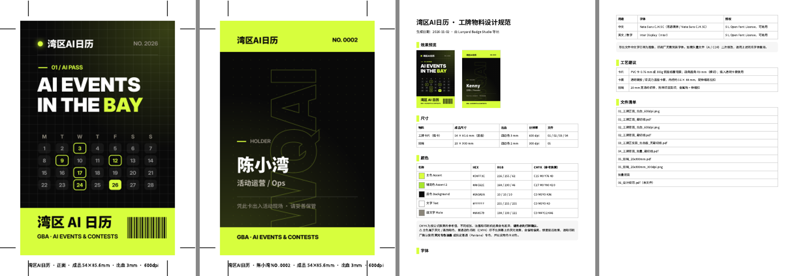

<p align="center"><b>🗓️ 湾区AI日历 出品</b> · Made by <b>湾区AI日历 (GBA AI Calendar)</b></p>

<p align="center"><b>👉 <a href="https://raw.githack.com/tgchtggn29-bit/lanyard-badge-studio/main/studio/index.html">立即打开工作台体验 · Open the Studio</a> 👈</b><br>
<sub>在线拖拽、旋转、翻面你的 3D 工牌，免安装；装上技能让你的 AI 智能体帮你设计 · Drag, spin & flip a 3D badge in your browser — no install</sub></p>

# Lanyard Badge Studio · 工牌工作室

**致各位创始人、一人公司（OPC）主理人和企业老板：**

参加展会、行业活动、社交聚会，或者每天在办公室里，一张有设计感的工牌，往往是别人记住你们公司的第一眼。现在不用找设计公司、不用等排期 —— 打开工作台，上传你们的 Logo 和品牌资料，交给你的 AI 智能体（Claude Code、Claude、Codex、Cursor……）说一句你想要的样子，就能生成**你们公司独一无二的工牌**：会掉落晃动的动态工牌视频、社交平台用的海报和横幅、配套的名片，以及可以直接交给印刷厂的印刷文件。

让客户、合作伙伴、服务商和供应商一见面就留下好印象。**赶紧来体验吧！**

> 🎁 **免费送你一份工牌展示视频**：做完工牌后，点任意「分享」按钮或「🎬 8秒动画」，就能**免费**拿到一段属于你们公司的 8 秒工牌展示视频（掉落 → 拖拽晃动 → 翻面 → 放大看细节），直接发朋友圈、小红书、X、Instagram。用命令行还能得到 1080P / 4K 高清版。

**To founders, solo-company (OPC) owners and business leaders:**

At trade shows, industry events, meetups — or simply around the office — a well-designed badge is often the first thing people remember about your company. No design agency, no waiting: open the Studio, upload your logo and brand materials, describe what you want in a quick chat, and get a **badge that is uniquely yours** — an animated lanyard-badge video, posters and banners for social media, matching business cards, and print-ready files you can hand straight to a print shop.

Make a great first impression on customers, partners, service providers and suppliers. **Come and try it!**

> 🎁 **A free showcase video of your badge**: once your badge is ready, hit any Share button or "🎬 8s video" to get a **free** 8-second showcase video of your own badge (drop → drag & swing → flip → zoom in) — ready for WeChat Moments, Xiaohongshu, X or Instagram. The CLI also renders 1080p / 4K versions.

<p align="center">
  
  &nbsp;
  
  &nbsp;
  
</p>
<p align="center"><sub>左：免费送的 8 秒工牌展示视频 · 右：品牌工牌动画 &nbsp;|&nbsp; Left: free 8s showcase video · Right: animated brand badge</sub></p>

<p align="center"></p>
<p align="center"><sub>网页工作台：中间是可拖拽 / 旋转 / 翻面的 3D 工牌，右下角是接入 AI 智能体的教程 —— 装上 badge-studio 技能，一句话出整套设计 · Studio: interactive 3D badge + AI agent setup guide</sub></p>

<p align="center"></p>
<p align="center"><sub>配套名片：暗夜网格 / 品牌色底 / 极简白，三种样式任选 · Matching business cards in 3 styles</sub></p>

---

## 能做什么

| 你给的 | 你拿到的 |
|---|---|
| 品牌名、品牌色、Logo、几句标语 | **工牌动画**：空白页开场 → 标签上下浮现 → 品牌大字弹出 → 工牌带动态模糊掉落、被挂绳拉住回弹、左右晃两下 → 停稳轻晃 → 品牌字放大缩回 → 收起循环 |
| | **MP4**：1080P / 4K，单次 & 循环 3 次；**首帧即封面**（存到 iPhone 相册缩略图就是工牌，不是空白页） |
| | **GIF**：高清版 + 自动压到 **10MB 以内**（公众号上限） |
| | **🎁 免费工牌展示视频**：8 秒，演示掉落、拖拽、翻面、放大，分享时自动生成；命令行另出 `showreel_8s_1080p.mp4` |
| | **图片**：停稳清晰预览图（正 / 背面）、透明底工牌、3:4 海报、紧凑横幅 |
| 员工名单 `people.csv`（可选） | **印刷包**：工牌正面 / 背面（54×85.6 mm，3 mm 出血，600 dpi）、带裁切线 PDF、出血版 PDF、**每人一张的批量背面**、挂绳 20×900 mm、**设计规范 PDF**（色值 HEX / RGB / CMYK 参考、字体授权、工艺建议） |
| 浏览器 | **3D 工牌**：拖着甩、右键 / Shift 拖动旋转、双击翻面、滚轮放大、「看细节」查看高清卡面 |
| Logo / 品牌资料 + 一句话 | **AI 智能体技能**：在 Claude Code / Claude 应用 / Codex / Cursor 里装上 `badge-studio` 技能，说「帮我做一套蓝白配色的公司工牌」，它会提取品牌色、写文案、渲染、自查，交付成片和印刷包 |
| 电话 / 微信 / 邮箱 / 地址 | **名片**：90×54 mm，三种样式（暗夜网格 / 品牌色底 / 极简白），带裁切线 PDF，按名单每人一张 |

内置的平台避坑：
- **网址检测**：配置里出现 `xxx.com / .ltd` 等网址会提醒（小红书等平台可能判定违规）。
- **首帧即封面**：成片从「工牌停稳」那一帧开始播，相册缩略图不再是空白。
- **GIF 大小阶梯压缩**：自动找到 10MB 以内画质最好的一档。
- **荧光色印刷提醒**：主色是荧光 / 高饱和色时，设计规范里会提醒印刷厂用专色油墨并打样。

## 三种用法

### 1. 网页工作台（不用写代码）

**不想安装：直接 [在线打开工作台](https://raw.githack.com/tgchtggn29-bit/lanyard-badge-studio/main/studio/index.html)。** 想在自己电脑上跑：

```bash
git clone https://github.com/tgchtggn29-bit/lanyard-badge-studio
cd lanyard-badge-studio
npm run studio        # 自动打开 http://localhost:5173/studio/ （无需 npm install）
```

> Windows 若提示「禁止运行脚本」，用 `npm.cmd run studio`，或直接 `node scripts/serve.mjs`。没装 Git 可以在 GitHub 页面点 Code → Download ZIP。

左边填品牌资料（名称、颜色、Logo、标语、标签、背面姓名职位、名片联系方式）。右下角是**接入 AI 智能体的教程**（见下文第 3 种用法）。中间实时看：
- **3D 工牌**：拖拽、旋转、翻面、放大看细节
- **动画预览**：可直接录一段 WebM
- **海报 & 横幅**、**名片**（三选一）、**印刷稿**：一键下载 PNG
- 改好后点「导出 brand.json」，交给命令行出成片

#### 分享

每张可以下载的图（预览图、海报、横幅、名片、印刷稿、「看细节」大图）下面都有分享栏：**X、Instagram、Facebook、LinkedIn、微博、复制链接**；手机上还有「📤 分享图片」，可以直接发到微信、Instagram 等 App。分享文案会带上工作台链接，朋友点开就能做自己的工牌。

### 2. 命令行出全套成片

需要 Node.js 18+ 和 [ffmpeg](https://ffmpeg.org/download.html)。

```bash
npm install                                   # 会自动下载 Chromium
npm run render -- --config examples/wqai/brand.json             # 视频 + GIF + 图片（1080P）
npm run render -- --config brand.json --res both                 # 同时出 4K
npm run print  -- --config brand.json --people people.csv        # 印刷包
npm run all                                                      # 用示例跑一遍全部
```

输出在 `out/<品牌名>/`：

```
out/湾区AI日历/
├── video/   badge_1080p_cover_x3.mp4   badge_1080p_cover_x1.mp4   badge_1080p_single.mp4   (badge_4k_*.mp4)
├── gif/     badge_hd.gif               badge_under_10MB.gif
├── images/  preview_1080x1920.png  preview_back_1080x1920.png  badge_transparent.png  poster_1242x1660.png  banner_*.png  namecard_*.png
└── print/   01_工牌正面_裁切线.pdf  02_工牌背面_裁切线.pdf  03_工牌正反面_出血版_无裁切线.pdf
             04_工牌背面_批量_裁切线.pdf  05_挂绳_20x900mm.pdf  06_设计规范.pdf
             07_名片_正反面_裁切线.pdf  07/08_名片_出血_600dpi.png  给印刷厂的说明.txt  批量背面/*.png
```

常用参数：`--res 1080|4k|both`、`--fps 30`、`--gif-limit 10`、`--strict-url`（发现网址直接报错）、`--card 54x85.6`、`--bleed 3`、`--dpi 600`、`--lanyard 20x900`、`--namecard-style grid|neon|minimal`。

### 3. 让你的 AI 智能体帮你设计（推荐）

项目自带技能 **badge-studio**：智能体会读官网和 Logo、提取品牌色、问你几个问题（标语、标签、要发哪些平台、要不要印刷）、写好 `brand.json`、渲染、自己先检查一遍，再把预览图给你审，最后交付成片和印刷包。

| 智能体 | 怎么装 |
|---|---|
| **Claude Code** | `git clone` 本项目 → 在目录里运行 `claude`，技能自动加载。想全局可用：`cp -r .claude/skills/badge-studio ~/.claude/skills/`（Windows：`xcopy /E /I .claude\skills\badge-studio %USERPROFILE%\.claude\skills\badge-studio`） |
| **Claude 应用**（网页 / 桌面 / 手机） | 下载 [`dist/badge-studio.zip`](dist/badge-studio.zip)，在 Claude 设置的「技能（Skills）」里上传；技能包里带了渲染引擎和脚本 |
| **Codex / Cursor / Windsurf / Trae / 通义灵码…** | 打开本项目文件夹，智能体会读 [`AGENTS.md`](AGENTS.md)；或对它说「先读 `.claude/skills/badge-studio/SKILL.md` 再帮我设计工牌」 |
| **支持 Skills 目录的其他智能体** | 把 `.claude/skills/badge-studio` 复制到它的 skills 目录 |
| **只有普通 AI 聊天**（ChatGPT / 豆包 / DeepSeek / Kimi） | 工作台右下角「复制提示词」→ 发给 AI → 把它返回的 JSON 粘贴回「套用到工牌」 |

然后对它说：

> 帮我做一套公司工牌：品牌叫「你的品牌」，Logo 在 ./logo.png，蓝白配色，要专业一点；员工名单在 people.csv，顺便出名片和印刷文件

网页工作台右下角也有同样的分步教程，命令可以一键复制。

## brand.json

完整示例见 [`examples/wqai/brand.json`](examples/wqai/brand.json)，所有字段都有默认值，只写想改的即可：

```json
{
  "name": "你的品牌",
  "theme": { "accent": "#D8FF3E", "accent2": "#A8E62E", "bg": "#0A0A0A" },
  "logo": "logo.png",
  "giantWord": "BRAND",
  "tags": ["今日活动", "报名中", "..."],
  "strap": ["BRAND · 2026", "你的品牌"],
  "card": {
    "brand": "你的品牌", "corner": "NO. 2026", "kicker": "01 / STAFF PASS",
    "headline": ["MAKE IT", "HAPPEN "], "highlight": "TODAY",
    "hero": { "type": "calendar", "highlights": [3, 9, 12], "today": 26 },
    "bandTitle": "你的品牌", "bandSub": "SLOGAN · 2026"
  },
  "back": { "name": "姓名", "title": "职位", "id": "NO. 0001", "note": "凭此卡出入" },
  "pulse": "你的品牌",
  "poster": { "title": ["你的", "品牌"], "sub": ["一句话介绍", "第二句"], "handle": "@你的账号", "channels": "公众号 · 小红书" }
}
```

- `card.hero.type`：`calendar`（日历格子）/ `image`（放吉祥物、产品图，配合 `card.hero.image`）/ `none`
- `theme.mode`：`dark`（默认）/ `light`
- `motion`：掉落时间、晃动幅度、阻尼等都能调，见 [`docs/DESIGN_NOTES.md`](docs/DESIGN_NOTES.md)

## 交给印刷厂

`npm run print` 生成的 `print/` 文件夹可以整包发给印刷厂 / 物料店。尺寸、出血、色值、工艺和对接注意事项见 [`docs/PRINT_GUIDE.md`](docs/PRINT_GUIDE.md)。

<p align="center"></p>

## 与现有方案的区别

[Vercel Ship 的 3D 工牌](https://vercel.com/blog/building-an-interactive-3d-event-badge-with-react-three-fiber) 和 React Bits / 21st.dev 的 Lanyard 组件都是**网页交互组件**，需要前端开发、3D 模型，也不导出成片。本项目面向运营和活动方：**一份配置 → 社媒成片 + 印刷文件**，纯 Canvas 2D，无需建模，结果可复现。

## 技术

- `src/engine.js`：纯 Canvas 2D 渲染引擎（浏览器 & 无头 Chromium 共用）。手调的阻尼振动模型 + 8 次子采样动态模糊。
- `studio/`：零依赖网页；3D 工牌 = Verlet 绳子 + CSS 3D 翻面卡片。
- `scripts/`：Playwright 逐帧渲染 → ffmpeg 编码；Chromium 按毫米尺寸输出 PDF。
- 字体：思源黑体（Noto Sans CJK SC）+ Inter，均为 SIL OFL 可商用。

## 一起设计更多工牌样式 · Contribute badge styles

**欢迎大家来设计工牌样式！** 新的卡面版式、配色方案、名片样式、挂绳图案、动效……都可以提交，我会持续更新、合并进来，让更多公司用上。

- 直接提 [Pull Request](https://github.com/tgchtggn29-bit/lanyard-badge-studio/pulls)：卡面在 `src/engine.js` 的 `cardFront` / `cardBack`，名片样式在 `NAMECARD_STYLES`，示例配置放 `examples/<你的品牌>/brand.json`
- 不会写代码也没关系：在 [Issues](https://github.com/tgchtggn29-bit/lanyard-badge-studio/issues) 里贴上你的设计稿或 `brand.json`，或者加我微信发给我
- 优秀样式会署名收录进工作台，供所有人选择

**Designers welcome!** New card layouts, colour themes, business-card styles, lanyard patterns and motion ideas are all appreciated — open a PR or an issue (a mock-up or a `brand.json` is enough). I'll keep merging and updating, with credit.

## License

MIT · 由 [@湾区AI日历](https://github.com/tgchtggn29-bit) 出品。欢迎 PR：新卡面模板、新动效、更多印刷规格。

## 联系开发者 · Contact

有问题、想合作、想定制工牌，或者想投稿样式，欢迎加我微信 **ke10157**（备注「工牌」）。

Questions, collaboration, custom badges or style submissions — add me on WeChat: **ke10157**.

<p align="center"></p>
